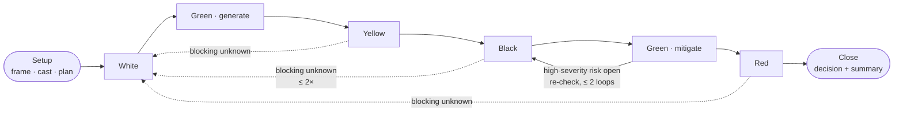
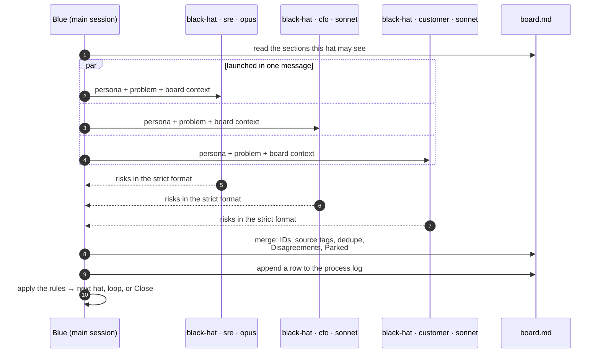

# Six Hats: a Claude Code prototype

A zero-code prototype of de Bono's Six Thinking Hats as a multi-agent process.
Use it to test the hat prompts and the board format before building a real
orchestrator.

## How it works

Your main Claude Code session wears the **Blue hat** and runs the session.
The other five hats are subagents. At each step, Blue sends a **panel** to work:
several copies of the same hat, each with a different persona and model, all
running in parallel. Their output is merged onto a shared markdown board.

### Session flow
The default plan, and where it can loop. Blue checks its rules after every step.



Blue's rules, checked in order after each step (the first one that applies wins):

1. Step budget (`--steps`) used up → **Close**
2. Blocking unknown still open → **White** again, focused on it (≤ 2×)
3. After Black, a high-severity risk has no mitigation → **Green · mitigate**, then **Black** (≤ 2 loops, then the risk is `accepted`)
4. Last step added nothing new → skip ahead
5. Otherwise → next hat in the plan

### One hat step
Every panelist wears the same hat at the same moment. Panelists never see each other's answers.



## Status
| Stage | What | State |
|---|---|---|
| 1 | Claude Code prototype (subagents + skill) | ✅ here |
| 2 | Plain-SDK orchestrator: enforced loop limits, temperature, tests | planned |
| 3 | Framework version (LangGraph or Mastra) if the loop logic grows | maybe |

## Files
| Path | Role |
|---|---|
| `.claude/agents/{white,red,black,yellow,green}-hat.md` | Hat subagents with strict output formats |
| `.claude/skills/six-hats/SKILL.md` | Blue facilitator: sequencing, loop rules, merging |
| `.claude/skills/six-hats/board-template.md` | Shared board (state) |
| `.claude/skills/six-hats/personas.md` | Persona cast and model defaults for each hat |
| `runs/` | One board per session (gitignored) |
| `CLAUDE.md` | Project instructions for Claude Code |

## Run
Start Claude Code in this directory, then:
```
/six-hats Should a 12-person startup move from AWS to bare metal? --interactive
```
Flags: `--interactive`, `--blind`, `--steps N`, `--panel N`.

## Known limits of this prototype
- You can't set temperature, so diversity comes from personas and model tiers only.
- Blue is the main session's LLM, so the loop limits are followed as
  instructions. Nothing enforces them in code.
- Not batch-runnable or unit-testable. That's the job of the plain-SDK version.
